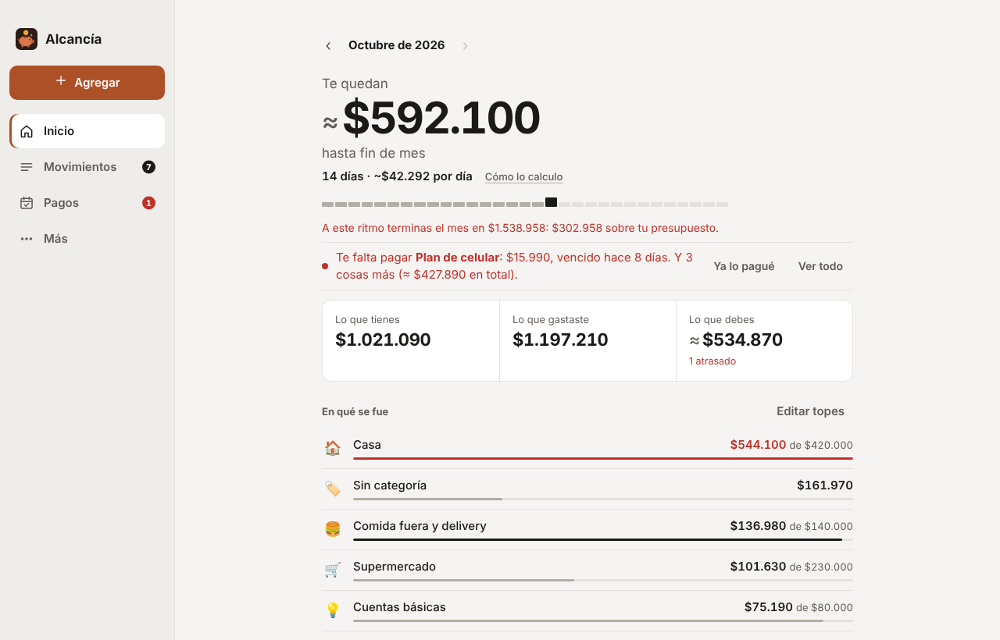
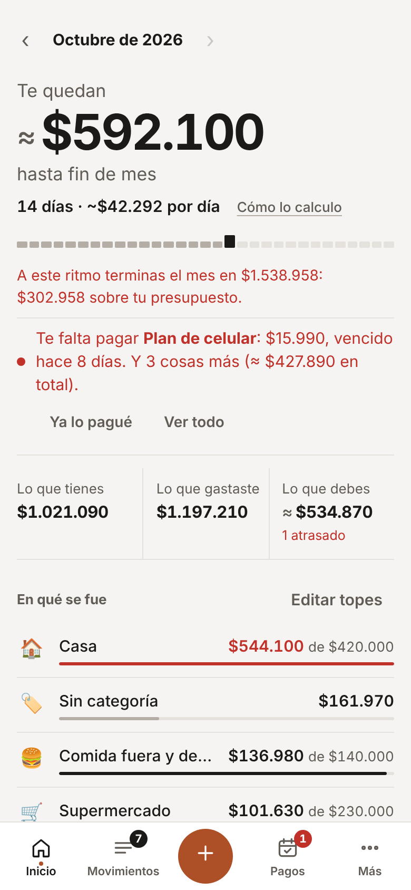
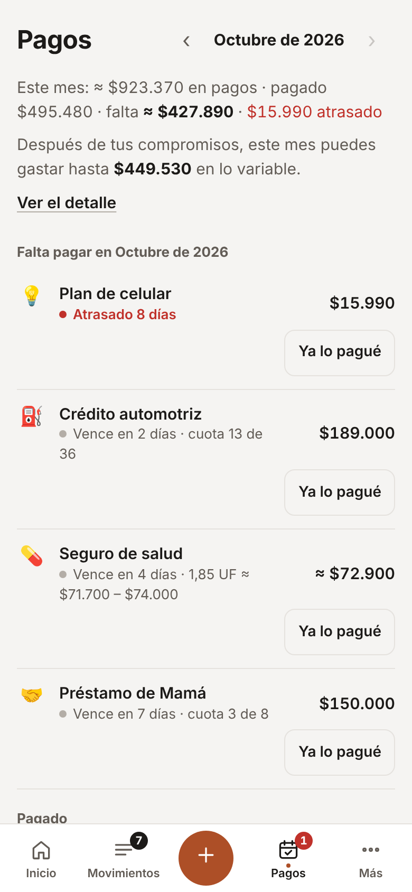
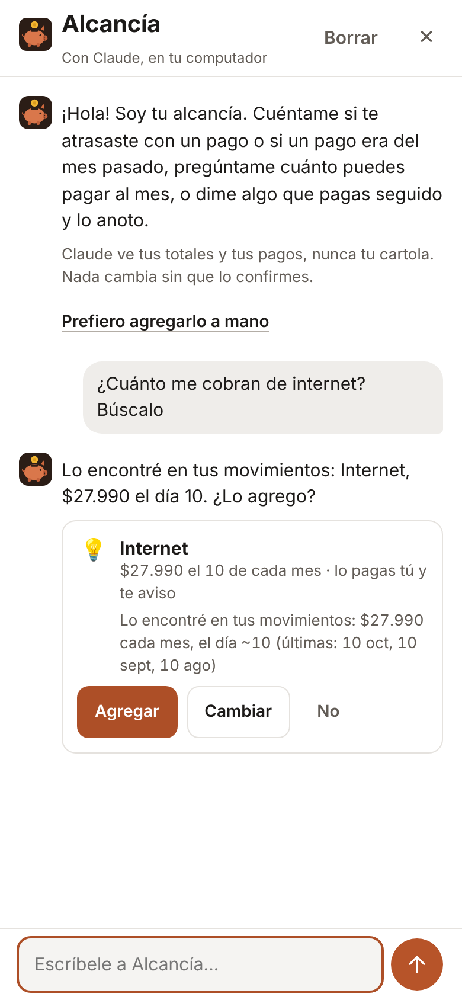

<p align="center"></p>

<h1 align="center">Alcancía</h1>

<p align="center"><b>Control de gastos para quienes nos cuesta medirnos.</b><br>
Juntas las cartolas de tus bancos y billeteras, Alcancía las ordena, te dice cuánto te queda hasta tu sueldo y qué falta pagar,
y tu propia IA te avisa a tiempo cuando algo se está pasando.<br>
Gratis, de código abierto y con tus datos en tu computador.</p>

<p align="center"><a href="https://alcancia-app.github.io/alcancia/"><b>Página</b></a> ·
<a href="https://alcancia-app.github.io/alcancia/demo/"><b>Pruébala en el navegador</b></a> ·
<a href="#instalar">Instalar</a> ·
<a href="https://github.com/alcancia-app/alcancia/discussions">Comunidad</a> ·
<a href="CONTRIBUTING.md">Cómo aportar</a> ·
<a href="#english">English</a></p>

<p align="center"><picture><source srcset="docs/img/app-resumen-oscuro.png" media="(prefers-color-scheme: dark)"></picture></p>
<p align="center">
<picture><source srcset="docs/img/app-celular-oscuro.png" media="(prefers-color-scheme: dark)"></picture>
<picture><source srcset="docs/img/app-pagos-oscuro.png" media="(prefers-color-scheme: dark)"></picture>
<picture><source srcset="docs/img/app-chat-oscuro.png" media="(prefers-color-scheme: dark)"></picture>
</p>
<p align="center"><sub>Datos ficticios. Inicio, Pagos y la conversación con Alcancía.</sub></p>

---

## Qué hace
- **Lee la cartola de cualquier banco o billetera** (CSV, Excel, PDF con texto, OFX/QFX, QIF, CAMT.053). Cada banco es una
  [*receta*](#recetas-cada-banco-del-mundo); si el tuyo no está, tu IA aprende a leerlo. Nunca duplica nada.
- **Movimientos que llegan solos:** [conexiones oficiales](#conexiones-automáticas) con una llave que creas tú (Mercado Pago,
  PayPal, Stripe, Buda.com, SimpleFIN, Up, Akahu) y la carpeta vigilada (descargas la cartola y se agrega sola).
- **Cuánto te queda hasta tu sueldo:** una sola cifra arriba, con los días que faltan, lo que puedes gastar al día y tu ritmo.
  Detecta tu sueldo y tu mes va [de sueldo a sueldo](#tu-mes-de-sueldo-a-sueldo).
- **Lo que tienes, lo que gastaste y lo que debes**, y en qué se fue cada peso, comparado con tus últimos 6 meses.
- **Categorías solas:** lo que le enseñaste, comercios conocidos y tu IA. Corriges una vez y aprende.
- **Pagos al día:** dividendo, arriendo, créditos, cuentas, suscripciones y tu sueldo. Reconoce cada pago en tu cartola, separa lo
  que **se paga solo** (PAC, PAT, suscripciones) de lo que pagas tú, avisa antes de que venza y detecta el interés por mora.
- **Préstamos entre personas** («mi tía me prestó 1.800.000 en 12 cuotas») y lo que te deben, aparte. Montos que varían y en UF.
- **[Conversa con Alcancía](#chat):** «me atrasé con el arriendo», «¿cuánto me cobran de internet? búscalo» o «mi mamá me prestó
  1,5 millones, ¿cuánto puedo pagar al mes?». Busca en tus movimientos sin mostrárselos a la IA, hace las cuentas con código y
  **nada cambia sin que lo confirmes**.
- **Consejos concretos** de tu IA: lo que va bien, a qué ponerle ojo y algo para esta semana. Gasto máximo sugerido por categoría.
- **[En tu celular](#celular)** (iPhone y Android, para mirar): tu Mac deja una copia cifrada con una frase que solo tú sabes en tu
  propia nube, y el celular te avisa antes de que venza un pago.
- **[Tu IA, fuera de Alcancía](#tu-ia-fuera-de-alcancía-mcp):** Claude, ChatGPT o Gemini pueden consultar tus finanzas con un
  servidor MCP de solo lectura.
- **Español e inglés.** Lo primero que te pregunta es el idioma.

<a id="instalar"></a>
## Instalar

| | Cómo | Estado |
|---|---|---|
| 🌐 **Navegador** | [Vista previa con datos ficticios](https://alcancia-app.github.io/alcancia/demo/): nada que instalar. | Para mirar cómo funciona |
| 🍎 **Mac** | [Desde el código](#instalar-en-mac-desde-el-código) con `bash build.sh` (macOS 15 y las herramientas de Xcode). | Funciona; aún sin versión publicada ni firma de Apple |
| 📱 **iPhone y Android** | [Desde el código](movil/README.md) con Xcode o Android Studio. Lee la copia cifrada que deja el Mac. | Fase 1: para mirar |
| 🪟 🐧 **Windows y Linux** | La misma interfaz, en una app de escritorio. | En camino |

Para la IA necesitas una de estas, con tu propia cuenta: Claude Code, Codex (ChatGPT) o Gemini CLI. La
[guía de tu IA](https://alcancia-app.github.io/alcancia/ia.html) explica cómo instalarla paso a paso. Sin IA, Alcancía igual lee
tus cartolas, reconoce tus pagos y te muestra tus cifras.

En GitHub, **Watch → Custom → Releases** te avisa cuando salga la primera versión para descargar.

## Tus datos son tuyos
- Todo queda en tu computador, en una carpeta con archivos abiertos (CSV y JSON) que puedes abrir con Excel o llevarte adonde quieras.
- **No hay servidores de Alcancía**, ni cuentas, ni publicidad, ni telemetría.
- La IA es **la tuya** (Claude Code, Codex o Gemini), con tu propia cuenta, y solo ve lo necesario: descripciones y montos para
  categorizar, totales por categoría para los consejos y, en la conversación, tus totales y tus compromisos (nunca la cartola).
  Nunca tus claves ni tus números de cuenta.
- Alcancía **nunca te pide la clave de tu banco**. Las cartolas las descargas tú.
- Si quieres verla en tu celular, tus números viajan **cifrados en tu computador** (con una frase que no se guarda en ninguna parte)
  a una carpeta de tu propia nube. Ni tu nube, ni nosotros, ni nadie sin la frase puede abrirlos.
- *Muy pronto:* respaldo **con candado** en tu nube (iCloud Drive, Google Drive, OneDrive, Dropbox) o en tu GitHub/GitLab: cifrado
  en tu computador, con una llave que solo tú tienes.

<a id="comunidad"></a>
## Cómo aportar
Alcancía es gratis y abierta, y la hacemos entre todos. Casi nada exige programar:
- 🏦 **Agrega tu banco:** agrega tu cartola en la app y deja que tu IA aprenda a leerla; al final te ofrece compartir **solo la
  receta** en el [catálogo](https://github.com/alcancia-app/alcancia-catalogo). Sirve para todos los de tu país.
- 💬 **Conversa** en [Discussions](https://github.com/alcancia-app/alcancia/discussions): dudas, ideas y cómo te ordenaste.
- 🧪 **Pruébala en tu sistema:** los issues con la etiqueta [`probar`](https://github.com/alcancia-app/alcancia/labels/probar).
- 🔌 **Suma una conexión oficial** de tu país: [Agregar un conector](CONTRIBUTING.md#agregar-un-conector-conexión-automática).
- 🛠️ **Programa, con o sin IA:** [`AGENTS.md`](AGENTS.md) es la guía para personas y para cualquier IA de programación. Empieza
  por [CONTRIBUTING.md](CONTRIBUTING.md) y los issues [`good first issue`](https://github.com/alcancia-app/alcancia/labels/good%20first%20issue).

Al participar aceptas el [código de conducta](CODE_OF_CONDUCT.md).

## Estado
Versión 0.1, recién nacida. Ya funcionan el motor (leer cartolas, recetas, categorías, pagos, resumen y consejos), la interfaz, la
conversación con Alcancía, la app de Mac (todavía sin versión publicada: por ahora se compila desde el código) y la app del celular
para iPhone y Android en su fase 1 (para mirar, con los datos que deja el Mac; se compila desde el código). Windows y Linux vienen en
camino.

---

## Cómo funciona
```
cartola.csv / .xlsx / .pdf ──► receta del banco ──► movimientos/AAAA-MM.csv ──► reglas + comercios + tu IA ──► resumen y consejos
                            (o tu IA crea una)        (sin duplicar)              (categorías)
```

## Formato de los datos
Todo vive en `~/Alcancia/` (en Windows, `C:\Users\<tú>\Alcancia`). Es un formato abierto: puedes armar tus propios scripts encima
(ver [`ejemplos/`](ejemplos/)). Si lo cambiamos, será de forma compatible y avisando.

| Archivo | Qué guarda |
|---|---|
| `movimientos/AAAA-MM.csv` | Un archivo por mes. Columnas: `id, fecha, descripcion, monto, moneda, categoria, cuenta, origen, nota`. `monto` negativo = gasto, positivo = ingreso, con punto decimal. `id` identifica el movimiento para no duplicarlo. Opcionales, **al final y solo si algún movimiento del mes las usa**: `medio` (`saldo`, `debito`, `credito` u `otro`: cómo se pagó, lo dice el conector), `cuotas` (en cuántas cuotas, 2 o más) y `cuota` (cuánto es cada una, con intereses; vacío = monto / cuotas). Lee las columnas por nombre (como `csv.DictReader`) y tus scripts siguen funcionando. |
| `categorias.json` | `[{"id", "nombre", "emoji", "tipo": "gasto" \| "ingreso" \| "neutro", "fijo"}]`. `neutro` = entre tus cuentas (no cuenta como gasto); `fijo` = se paga una vez al mes. |
| `presupuesto.json` | `{"moneda": "CLP", "mensual": {"<categoria>": tope}}` |
| `reglas.json` | `[{"contiene": "TEXTO", "categoria": "<id>"}]`: lo que Alcancía aprende cuando corriges una categoría. |
| `cuentas.json` | `[{"id", "nombre", "receta", "moneda", "saldo"}]`. `saldo` es opcional: `{"monto", "fecha", "origen"}`, el último saldo que se conoce de la cuenta. `origen` = `conector` (lo informa el servicio, p. ej. el disponible de Mercado Pago), `cartola` (la columna de saldo de la última fila) o `persona` (lo anotaste tú). Ver [Las tres cifras](#tres-cifras). |
| `consejos/AAAA-MM-DD.md` | Los consejos de tu IA. |
| `compromisos.json` | Lo que pagas o recibes seguido. Ver [Compromisos](#compromisos-formato). |
| `cuentas.json` (cont.) | Las cuentas que vienen de una conexión llevan `"conector"` en vez de `"receta"`. |
| `.alcancia/config.json` | Ajustes. Entre ellos `inicio_mes`: `{"modo": "dia" \| "sueldo", "dia": 25}` (tu mes parte el día 1 o cuando llega tu sueldo; con `"auto": true` lo puso Alcancía al detectar tu sueldo y lo sigue ajustando, hasta que elijas otra cosa), `avisos` (`true` si quieres avisos de tus compromisos) y `uf`: `{"valor": 39500, "fecha": "AAAA-MM-DD", "variacion_mensual": 1.5}` (el valor de la UF que escribiste y cuánto puede variar al mes). |
| `.alcancia/` | Ajustes de la app, `avisos.json` (qué avisos ya se mostraron), recetas descargadas o creadas por ti, `conexiones.json` (estado de cada conexión, sin llaves), `vigilar.json` (cartolas ya revisadas en Descargas) y `chat.json` (la conversación con Alcancía: los últimos 50 mensajes, ya sin RUT ni números de cuenta; «Borrar» la borra). Las llaves de las conexiones viven en el Llavero de tu sistema, nunca en esta carpeta. |

### Las tres cifras del Resumen
<a id="tres-cifras"></a>
- **Lo que tienes** (hoy): la suma de los saldos de tus cuentas. Para cada cuenta se usa el último saldo conocido (`cuentas.json`,
  campo `saldo`) más los movimientos de los días siguientes. Si un conector sabe pedir el saldo a su API oficial, se guarda en cada
  sincronización (`origen: "conector"`): en **Mercado Pago** es el saldo disponible que muestra su app (`available_balance` de
  `/users/{id}/mercadopago_account/balance`); también Up, Akahu y SimpleFIN. Si no, la persona lo anota una vez y Alcancía sigue con
  los movimientos; cuando lo corrige, dice si había una diferencia con lo que calculaba y parte desde el saldo corregido. Las compras
  con crédito no mueven el saldo (van a la tarjeta). Sin ningún saldo, la app invita a anotarlo: nunca muestra un cero inventado.
- **Lo que gastaste** (en tu mes): los gastos, sin lo de «Entre mis cuentas». Una compra con crédito en cuotas cuenta por la cuota de
  cada mes (la primera, el día de la compra); una devolución (un monto positivo con categoría de gasto) descuenta de esa categoría.
- **Lo que debes** (hoy): lo que falta pagar de tus compromisos este mes (y lo atrasado), lo que te queda de cada crédito (cuotas
  que faltan × cuota, o el saldo que anotaste), lo comprado con crédito desde el último pago de tarjeta (un movimiento que diga
  «PAGO TARJETA», «PAGO TC»…; nunca más atrás que el mes anterior) y las cuotas que vienen de compras en cuotas. Muestra aparte lo
  que toca pagar este mes.

**Devoluciones de Mercado Pago:** lo devuelto queda como un movimiento aparte, «Devolución: …», positivo, en la fecha de la
devolución y con la categoría de la compra (si ya la tenía); su id sale de «<pago>|devolucion», así nunca se duplica.

### Compromisos (formato)
<a id="compromisos-formato"></a>
`compromisos.json` = `{"formato": 1, "compromisos": [...], "descartados": ["CLAVE", ...]}`. Cada compromiso:

| Campo | Qué es |
|---|---|
| `id` | `c-` + letras y números. |
| `nombre` | Hasta 60 caracteres. Nunca un número de cuenta: las secuencias de 6 o más dígitos se quitan al guardar. |
| `tipo` | `deuda`, `cuenta`, `suscripcion`, `transferencia`, `prestamo`, `ingreso` u `otro`. |
| `con`, `prestamo` | Solo en `prestamo`: con quién (un nombre, sin números) y `{"total", "interes", "cuota", "ultima"}`: lo prestado, el interés simple en % sobre el total (0 si no hay), la cuota y la última cuota (ajusta el redondeo). `monto` = `cuota`; `cuotas_total` es obligatorio y `fecha_fin` se calcula. `signo: "gasto"` = te prestaron; `"ingreso"` = tú prestaste (te deben). |
| `signo` | `gasto` o `ingreso`. |
| `monto`, `moneda` | Monto positivo y código de 3 letras, o `"UF"` con el monto en UF (hasta 4 decimales, p. ej. `12.75`). |
| `aproximado` | Opcional, para montos que varían: `{"variacion": 3}` (± ese porcentaje) o `{"min": 465000, "max": 495000}` (en la moneda del compromiso; el monto va entre los dos). Se muestra «≈ $480.000 (entre $465.000 y $495.000)» y el pago se reconoce en todo el rango. |
| `frecuencia` | `mensual` (con `dia` 1–31; si el mes es más corto, el último día), `semanal` (`dia` 1 = lunes … 7 = domingo), `anual` o `una_vez` (con `fecha` AAAA-MM-DD). |
| `categoria` | Id de una categoría (o vacío). |
| `buscar` | Palabras para reconocer el pago en la cartola (sin tildes ni mayúsculas). Sin palabras, se reconoce por el monto exacto. |
| `tolerancia` | Cuánto puede variar el monto, en % (por defecto 5). |
| `cuotas_total`, `cuotas_pagadas` | Opcionales. Las pagadas son las de antes de `desde`; cada pago reconocido después suma una. |
| `fecha_fin`, `saldo` | Opcionales: cuándo termina y lo que te queda por pagar (como lo anotaste). |
| `pago` | Opcional, solo en gastos: `"automatico"` (se cobra solo: PAC, PAT, una suscripción con tarjeta) o `"manual"` (lo pagas tú). Sin el campo, Alcancía lo deduce: «se paga solo» si el nombre o `buscar` traen una palabra de `compromisos_conocidos.json` (`automatico`: PAC, PAT, cargo automático, Netflix, Spotify, Meli+…); si no, deudas, préstamos, cuentas, suscripciones y transferencias se pagan a mano, y un `otro` queda sin etiqueta (se recuerda igual). No confundir con `pagos[…].como`, que dice cómo se reconoció cada pago. |
| `activo` | `false` = en pausa (ni se recuerda ni se busca). |
| `desde` | Desde qué día cuenta (AAAA-MM-DD). Un vencimiento anterior solo se da por pagado si ya estaba pagado. |
| `origen` | `manual`, `detectado` (salió de tu cartola) o `ia` (lo entendió tu IA). |
| `pagos` | Por periodo (`AAAA-MM` en mensual, `AAAA` en anual, la fecha en semanal y una vez): `{"como": "automatico", "fecha", "movimiento", "monto", "mora"?}` cuando se reconoció en la cartola (`mora`: `{"monto", "dias", "movimiento"?}` si se pagó atrasado con interés por mora), `{"como": "manual", "fecha"}` cuando marcaste «ya lo pagué», y `"no_es": ["<id de movimiento>"]` cuando dijiste «no es este». Cuando confirmas en la conversación que un pago «era del mes pasado», se usa este mismo formato: el periodo anterior queda con ese pago (`como`, `fecha`, `movimiento`, `monto`) y el de este mes con el movimiento en `no_es`. |

**Interés por mora.** Un pago mensual o anual se reconoce hasta 20 días después del vencimiento; si llegó atrasado y más alto
que lo esperado (más allá de la tolerancia o del rango, hasta +30 % y con sus palabras), la diferencia es interés por mora. Si
además hay un cargo aparte hasta 7 días antes o después del pago (INTERES, MORA, RECARGO, COBRANZA, MULTA, LATE FEE…: la lista
está en `compromisos_conocidos.json`, `mora`), se suma y ese cargo queda en la categoría «Intereses y cargos» 🧾 (si no tenía
otra). Se muestra «Pagado el 18 con 8 días de atraso · $4.320 de interés por mora» y, en el Resumen, lo pagado este año.

`descartados` son las sugerencias que dijiste que no son compromisos. **Cómo se reconoce un pago:** el movimiento del signo
correcto, en la moneda del compromiso, con el monto dentro de la tolerancia y alguna palabra de `buscar`, entre 10 días antes y 7
después del vencimiento (hasta 20 días después si es mensual o anual: un pago atrasado). Un movimiento cuenta para un solo compromiso: primero lo marcado a mano y después las parejas que calzan
mejor (más cerca de la fecha, luego del monto). La lista de palabras que delatan un compromiso (dividendo, crédito, cuota, PAC,
seguro, arriendo, colegio, plan celular…) es solo datos: [`bin/compromisos_conocidos.json`](bin/compromisos_conocidos.json), por país.

Un movimiento con categoría `transferencia` (entre tus cuentas) solo puede pagar un compromiso de tipo `transferencia`.

**Se paga solo o lo pagas tú.** Lo que se paga solo no se te cobra: en Pagos dice «Se paga solo el 25 oct» (y «Pagado» cuando
aparece el cargo), sin «Ya lo pagué» ni avisos de «por vencer». Si pasaron 3 días del vencimiento y el cargo no aparece, dice «No
vimos el cargo» (puede que el cobro haya fallado) y, con los avisos activados, avisa una vez. Lo que pagas tú se recuerda como
siempre. «Lo que debes» y «Te quedan» cuentan los dos: la plata sale igual.

### Préstamos
Con `total` y `cuotas_total`, la cuota es `total × (1 + interes/100) ÷ cuotas` redondeada hacia abajo y la última se lleva la
diferencia, así la suma da justo. Si `prestamo.cuota` trae una cuota fija que calza (al menos lo justo, no más que el total y sin
pagarlo todo antes de la última; p. ej. 1.500.000 en 12 cuotas de 130.000), se respeta y la última es lo que falta (70.000). Si no dices el día, el primer pago cae el día de tu sueldo (`inicio_mes` en modo sueldo) o el 25.
Lo que queda se calcula con las cuotas pagadas. Los préstamos que hiciste suman en «Te deben», aparte de «Lo que debes».

### Montos aproximados y en UF
Un compromiso con `aproximado` muestra un rango y su pago se reconoce si cae dentro de él (o dentro de la tolerancia de siempre) y trae alguna de sus palabras; sin palabras, solo el monto exacto.
Uno en **UF** (`moneda: "UF"`) se paga en pesos, así que Alcancía **estima** cuánto es, sin conectarse a ningún lado: usa el valor
de la UF que sale del último pago reconocido de ese compromiso (pesos pagados ÷ UF); si aún no hay pagos, el más reciente entre el
que escribiste en Ajustes («Valor de la UF hoy») y el que sale del pago de otro compromiso en UF. Como la UF sube de a poco, el rango
se abre ±1,5 % por cada mes desde ese valor (configurable en Ajustes) más la variación del compromiso: «12,75 UF ≈ $490.000 –
$506.000». **Es una estimación, no el valor oficial.** Si no hay cómo estimarlo, se muestra «12,75 UF (aún no sé cuánto es en
pesos)» y no entra en los totales. Un pago en UF se reconoce por sus palabras (`buscar`) y, si escribiste el valor de la UF, también
por el monto (±15 %). En «Lo que debes» y el gasto máximo sugerido, lo aproximado cuenta por su máximo (y los ingresos por su
mínimo), para no quedarte corto. Al detectar un pago que varía mes a mes, se propone como aproximado; si parece un dividendo o la
descripción dice UF, se pregunta «¿Se paga en UF?».

### Tu mes: de sueldo a sueldo
Con `inicio_mes` en modo `sueldo` y el día en que te pagan (p. ej. 25), cada «mes» va de sueldo a sueldo y se llama como el mes
donde cae la mayor parte (si te pagan del 16 en adelante, el mes en que termina: «noviembre» = 25 oct – 24 nov; si te pagan del 2
al 15, el mes en que parte). Si anotaste tu sueldo como compromiso (tipo `ingreso`, categoría `sueldo`), el mes parte el día que
de verdad llegó, si llegó entre 12 días antes y 7 después del día de siempre. Los bonos e ingresos extra cuentan en el mes en que
caen. Los archivos `movimientos/AAAA-MM.csv` no cambian: siguen por mes calendario.

**Sueldo detectado.** Si `inicio_mes` no está en tu config, Alcancía busca tu sueldo: el ingreso más grande que se repite en al
menos 2 de los últimos 3 meses (o 3 de 4) con monto parecido (±25 %), que no es entre tus cuentas, y que dice sueldo (REMUNERACION,
SUELDO, NOMINA, PAYROLL…) o es al menos la mitad de lo que entró ese mes. Si lo encuentra, guarda `inicio_mes` con el día típico
(la mediana del día de llegada) y `"auto": true`, crea el compromiso «Sueldo» (aproximado, `origen: "detectado"`) y deja esas
llegadas como Sueldo (con una regla si su descripción no calza con otros movimientos). Si no hay un sueldo claro, no inventa: el
mes queda calendario y te invita a decir cuándo te pagan.

**Próximo sueldo y días hábiles.** El próximo sueldo es el día típico del periodo siguiente; si cae sábado, domingo o feriado, se
corre al día hábil anterior (lo común en Chile) o al siguiente si eso es lo que muestran tus llegadas. Si ya pasó un día hábil
después de esa fecha sin llegada, el mes anterior sigue (hasta 7 días) y el Resumen pregunta «¿Aún no te pagan?». Los feriados
nacionales de Chile están en [`bin/feriados.json`](bin/feriados.json) (solo datos, 2025–2028, incluidos los que se corren a lunes
y los irrenunciables) y **se actualizan cada año** con el decreto oficial; para otros países se usan solo los fines de semana.

### Conversar con Alcancía
<a id="chat"></a>
«Cuéntale a Alcancía» (en «+» y en el Inicio, «Pregúntale a Alcancía») es un chat con tu alcancía. Responde tu IA, con tu cuenta,
y **nada se aplica solo**: lo que propone aparece como una tarjeta («Agregar», «Sí, corrígelo», «Cambiar», «No»).
- **Lo que ve tu IA:** tu periodo y los días que quedan, tu ingreso típico, tu gasto típico sin compromisos, lo comprometido al mes
  y tu margen, las tres cifras del Inicio (solo totales) y, por cada compromiso, una referencia (C1, C2…), su nombre, tipo, monto,
  día, si se paga solo, sus palabras para reconocerlo, el estado de este mes y sus últimos 3 pagos (fecha, monto y a qué vencimiento
  se asignaron). Nunca descripciones de movimientos, ids ni números de cuenta. Tus últimos 10 mensajes van sin RUT ni números largos.
- **Margen mensual** = ingreso típico − gasto típico − compromisos al mes. Ingreso típico: tus ingresos anotados (el sueldo, por su
  mínimo si varía) o, si no hay, el promedio de lo que entró en los últimos 3 meses completos. Gasto típico: el promedio de «Lo que
  gastaste» en esos meses, sin los movimientos que son pagos de un compromiso. Compromisos: los gastos vigentes al mes, por su máximo.
- **Plan de préstamos** («mi mamá me prestó 1,5 millones y mi tío Matías 4»): tu IA solo dice quién y cuánto; las cuentas las hace
  Alcancía. Usa como máximo el 75 % del margen (el resto queda de colchón), busca los menos meses en que las cuotas caben (cada una
  redondeada hacia arriba a 1.000, 5.000 o 10.000, según su tamaño, y en proporción a lo que debes) y propone un préstamo por persona,
  «lo pago yo» y con aviso, desde el día después de tu próximo sueldo (o el 1 del mes que viene). Si no alcanza ni en 60 meses, te
  lo dice y te deja la cuota más chica.
- **¿Es el mismo préstamo?** Si lo que le cuentas se parece a un préstamo que ya tienes anotado (la misma persona —«mamá», «mi
  mami» y «Mamá» son la misma— o, si no se sabe quién, un total parecido, ±15 %), Alcancía pregunta antes de agregar nada: «Ya
  tienes anotado «Préstamo de Mamá» ($150.000 al mes, quedan 8 cuotas). ¿Es el mismo?». **Es otro:** se propone como uno nuevo.
  **Es el mismo:** no se crea otro; en un plan, su cuota vuelve a tu margen (no se cuenta dos veces), se planifica lo que te falta
  pagar, se recalculan todas las deudas y se propone **actualizar** el que ya tenías (mismo nombre y palabras, cuotas nuevas desde
  el día después de tu próximo sueldo). Tu respuesta queda en `chat.json` (`estados`, `es:<n>`).
- **«Ese pago era del mes pasado»:** si dices que algo de este mes aún no lo pagas y aparece pagado este mes, mientras el
  vencimiento anterior no tiene pago, Alcancía propone mover ese pago al anterior (queda pagado con atraso) y dejar este pendiente.
- También puede proponer anotar un compromiso nuevo, marcar algo como pagado o pendiente, o cambiar el monto, el día, cómo se paga o
  cuándo termina uno. Si tu IA no responde o responde algo que no sirve, el chat te lo dice; nunca queda en blanco.

### Copia para el celular
<a id="copia-celular"></a>
`Alcancia-celular.alcancia`, en la carpeta de tu nube que elegiste en el Mac (Ajustes → «Alcancía en tu celular»). Es un JSON
(versión 1) que se abre con cualquier biblioteca estándar de AES-GCM; el código está en [`ui/copia.js`](ui/copia.js) y la pieza «cifrado» ([`ui/cifrado.js`](ui/cifrado.js)):
```
{"alcancia": "copia-celular", "version": 1,
 "kdf": {"alg": "PBKDF2-SHA256", "iteraciones": 600000, "sal": "<16 bytes, base64>"},
 "cifrado": "AES-256-GCM",
 "verificador": {"iv": "<12 bytes>", "datos": "<«alcancia» cifrado, AAD «alcancia:celular:verificador»>"},
 "datos": {"iv": "<12 bytes, nuevo en cada escritura>", "datos": "<contenido cifrado + etiqueta de 16 bytes, AAD «alcancia:celular:1»>"}}
```
- **La llave** = PBKDF2-SHA256(frase en NFC, sal, 600.000 vueltas) → 64 bytes: los primeros 32 son la llave AES (los mismos
  que daba la versión anterior, que derivaba solo 32; una llave guardada de 32 bytes sigue sirviendo). La frase la eliges una vez (12 caracteres o más) y
  **no se guarda en ninguna parte**: el Mac guarda en su Llavero la llave ya derivada, y el celular, solo si marcas «Recordarla en
  este teléfono», en su Llavero (iOS) o cifrada con el Keystore (Android). Al abrir no se aceptan menos de 100.000 vueltas.
- **El verificador** permite decir «la frase no es la correcta» sin tocar los datos. Cualquier cambio en el archivo (o un archivo
  a medio subir) hace fallar la etiqueta GCM: el celular sigue mostrando la última copia que abrió bien. Una `version` mayor que la
  que conoce la app pide actualizarla.
- **El contenido** (descifrado) es `{"formato": 1, "generado", "version", "hoy", "estado": {...}}`, con solo lo que la interfaz
  necesita para pintar: `config` (`pais`, `moneda`, `inicio_mes`, `uf`), `movimientos` (las columnas de los CSV), `categorias`,
  `presupuesto`, `cuentas` (`id`, `nombre`, `moneda`, `saldo`, `conector`), `consejos`, `compromisos`, `conexiones` (si está
  conectada y cuándo fue la última vez), `feriados` y las palabras de `compromisos_conocidos.json`. **Nunca** llaves ni tokens de
  conectores, rutas de tu computador, la conversación con Alcancía, recetas, la carpeta vigilada ni los datos de tu IA.
- El Mac la escribe de una vez (sin archivos a medias) al abrir, cuando cambian tus datos (importar, sincronizar, categorizar…) y
  cada 6 horas aunque no haya cambios. Nunca borra la copia: si dejas de usarla, la borras tú.

## Alcancía en tu celular
<a id="celular"></a>
La misma interfaz, en una app para iPhone y Android ([`movil/`](movil/), con [Capacitor](https://capacitorjs.com)). El Mac sigue
siendo la fuente: lee tus cartolas y conexiones y guarda las llaves; el celular **mira**.
1. En el Mac: Ajustes → **Alcancía en tu celular** → elige una carpeta de tu nube (iCloud Drive, Google Drive, OneDrive o
   Dropbox) y crea una frase. Alcancía deja ahí `Alcancia-celular.alcancia`, cifrado ([formato](#copia-celular)).
2. En el celular: elige tu idioma, toca **Elegir el archivo**, búscalo en esa carpeta y escribe tu frase. El celular guarda el
   permiso para volver a leerlo: al abrir la app y al volver a ella trae la copia más nueva.
3. Si quieres, activa **Avisarme antes de que venza un pago**: un aviso 3 días antes y el día que vence, solo de lo que pagas tú
   (lo que se paga solo no), sin montos y con un título genérico. El permiso del sistema se pide recién ahí.

En esta fase, categorizar, marcar pagos, agregar cartolas o compromisos, conectar cuentas y conversar con Alcancía se hacen en el
Mac (el celular no lo ofrece; si llegas a tocar algo así, te lo dice). La app del celular no usa internet: no tiene servidores, ni
cuentas, ni llaves de conectores, ni telemetría. Cómo instalarla desde el código: [`movil/README.md`](movil/README.md).

## Cartolas en PDF
Algunos bancos solo entregan la cartola en PDF. Alcancía lee los PDF **con texto** (los que genera el banco, no los escaneados) sin
librerías: saca el texto con su posición, lo arma como tabla (filas por altura, columnas alineadas con la fila de encabezados) y lo
pasa por la receta del banco, igual que un CSV. Si tu banco no tiene receta, tu IA ve las primeras filas de esa tabla y aprende a
leerla. Un PDF escaneado (una foto) o protegido con clave no se puede leer: Alcancía te lo dice y te sugiere descargar la cartola
en CSV o Excel, o guardar el PDF sin clave.

## Recetas: cada banco del mundo
Una receta es un JSON de **solo datos** (nunca código), así que cualquiera puede agregar su banco sin programar. El formato está en
[`recetas/README.md`](recetas/README.md) y el catálogo comunitario vive en
[alcancia-app/alcancia-catalogo](https://github.com/alcancia-app/alcancia-catalogo). ¿Tu banco no está? Abre la app, agrega la cartola
y deja que tu IA aprenda a leerla: al final te ofrece compartir **solo la receta**, nunca tus movimientos.

## Conexiones automáticas
Casi ningún banco deja que una persona use su propia API todavía, así que Alcancía junta todo lo que sí existe, siempre con
**conexiones oficiales y una llave que creas tú** (nunca tu usuario y clave del banco):

| Servicio | Dónde | Qué trae | Ojo |
|---|---|---|---|
| Mercado Pago | AR, BR, CL, CO, MX, PE, UY | Pagos hechos y recibidos (últimos 12 meses) | La llave da acceso completo a la cuenta (no existe una de solo lectura). Beta. |
| PayPal | Todo el mundo | Movimientos de 3 años | Solo cuentas Business. Beta. |
| Stripe | Todo el mundo | Cobros, comisiones y transferencias | Llave restringida de solo lectura. Beta. |
| Buda.com | CL, PE, CO | Depósitos y retiros en pesos/soles | Llave de solo lectura. Beta. |
| SimpleFIN | EE. UU. y Canadá | Miles de bancos | Servicio aparte, US$1,50 al mes. Beta. |
| Up | Australia | Todas tus cuentas | Token personal de solo lectura. Beta. |
| Akahu | Nueva Zelanda | Casi todos los bancos | App personal gratuita. Beta. |

*Beta* = funciona con la API oficial y pasa las pruebas, pero falta que alguien lo use con su cuenta real. Si lo pruebas, cuéntanos.
Para todo lo demás está la **carpeta vigilada**: descargas la cartola como siempre y Alcancía la agrega sola. Cuando tu país tenga
finanzas abiertas oficiales (en Chile, la CMF parte en julio de 2027), las sumamos. Guía paso a paso:
[alcancia-app.github.io/alcancia/conectar.html](https://alcancia-app.github.io/alcancia/conectar.html). ¿Conoces otra API oficial?
Mira [Agregar un conector](CONTRIBUTING.md#agregar-un-conector-conexión-automática).

## Tu IA, fuera de Alcancía (MCP)
`bin/mcp_servidor.py` es un servidor [MCP](https://modelcontextprotocol.io) de **solo lectura**: corre en tu computador, lo abre tu
IA cuando lo necesita y no tiene servidores ni puertos abiertos. Herramientas: `resumen_del_mes`, `gastos_por_categoria`,
`buscar_movimientos`, `principales_comercios`, `comparar_meses`, `presupuesto`, `compromisos` (qué está pagado, pendiente o
atrasado este mes) y `cuentas_y_datos`. En la app: **Conexiones → Tu IA,
fuera de Alcancía → Conectar** (Claude Desktop, Claude Code, ChatGPT/Codex, Gemini CLI y Antigravity). A mano:
```bash
claude mcp add --scope user alcancia -- python3 ~/Developer/alcancia/bin/mcp_servidor.py
codex mcp add alcancia -- python3 ~/Developer/alcancia/bin/mcp_servidor.py
gemini mcp add -s user alcancia python3 ~/Developer/alcancia/bin/mcp_servidor.py
```
Lo que tu IA consulta viaja a tu proveedor de IA con tu cuenta, igual que si se lo escribieras.

## Instalar en Mac (desde el código)
Necesitas macOS 15 y las herramientas de Xcode (`xcode-select --install`).
```bash
git clone https://github.com/alcancia-app/alcancia ~/Developer/alcancia
cd ~/Developer/alcancia && bash build.sh      # compila, arma la app con su propio Python y la instala en ~/Applications
open ~/Applications/Alcancia.app
```
La app no está firmada por Apple todavía: si macOS avisa, ve a Ajustes del Sistema → Privacidad y seguridad → «Abrir igualmente».

## Desarrollo
Necesitas Python 3 (solo biblioteca estándar) y Node para las pruebas de la interfaz.
```bash
cd ui && python3 -m http.server 8765        # interfaz con datos ficticios: http://localhost:8765 (?idioma=en, ?bienvenida, ?vacio)
python3 bin/importar.py vista cartola.csv /tmp/salida.json   # probar una cartola (no guarda nada)
bash pruebas/correr.sh                      # todas las pruebas
```
Lee [`AGENTS.md`](AGENTS.md) antes de cambiar algo: sirve igual para personas y para tu IA.

## Seguridad
¿Encontraste un problema de seguridad? Avísanos **en privado**, nunca en un issue público: cómo hacerlo y qué cubre está en
[`SECURITY.md`](SECURITY.md). *(Security issues: please report privately, see [`SECURITY.md`](SECURITY.md).)*

## Licencia
[AGPL-3.0](LICENSE). Puedes usar, estudiar, cambiar y compartir Alcancía. Si la ofreces como servicio o la distribuyes modificada,
tienes que publicar tu código con la misma licencia: así nadie puede tomarla y venderla cerrada.

---

## English
**Alcancía** ("piggy bank") is a free, open-source spending tracker for people who struggle to keep their spending in check. Add
statements from any bank or wallet in the world (CSV, Excel or text-based PDF); Alcancía sorts them without duplicates, your own AI (Claude Code,
Codex or Gemini, with your account) fills in categories and gives you concrete tips, and you see in time when a category is running
over budget. Commitments (rent, loans, bills, subscriptions, salary) can be added in your own words; Alcancía spots each payment in
your statements, shows what's still due (overdue first), tracks loan installments, suggests a spending limit for day-to-day
expenses and, on Mac, reminds you before things are due. You can also chat with your piggy bank: tell it you fell behind, that a
payment was last month's, or ask how much you can pay each month on money family lent you (if that loan is already on your list, it asks whether it's the same one
so it isn't counted twice); it proposes, you confirm. Your month can run from payday to payday. Your data stays on your computer in open files: no servers, no accounts, no ads, and it never asks for your bank
password. A phone app (iPhone and Android, phase 1, read-only) shows the same screens: your Mac leaves a copy encrypted with a passphrase
only you know (PBKDF2-SHA256 + AES-256-GCM) in a folder of your own cloud, and the phone opens it and can remind you before your
payments are due. Each bank is supported through a data-only *recipe* (plus OFX, QIF and CAMT.053 out of the box); if yours is missing, your AI
learns it and you can share just the recipe with the community. Transactions can also arrive automatically: official APIs with a key
you create (Mercado Pago, PayPal, Stripe, Buda.com, SimpleFIN for US/Canada banks, Up, Akahu) and a watched Downloads folder. A
read-only local MCP server lets your own AI (Claude, ChatGPT/Codex, Gemini) answer questions about your finances. Spanish-first, English included. Licensed under AGPL-3.0.

**Try it:** [browser preview with made-up data](https://alcancia-app.github.io/alcancia/demo/) (add `?idioma=en`) · **Mac:**
[build from source](#instalar-en-mac-desde-el-código) (`bash build.sh`, macOS 15; no signed release yet) · **iPhone and Android:**
[build from source](movil/README.md) (phase 1, read-only) · **Windows and Linux:** coming. Questions and ideas are welcome in
[Discussions](https://github.com/alcancia-app/alcancia/discussions), in English or Spanish; see [CONTRIBUTING.md](CONTRIBUTING.md).

---

[](https://pieza-app.github.io/pieza/) · Las piezas comunes (tu IA, idiomas, actualizaciones…) viven en [Pieza](https://github.com/pieza-app/pieza).
